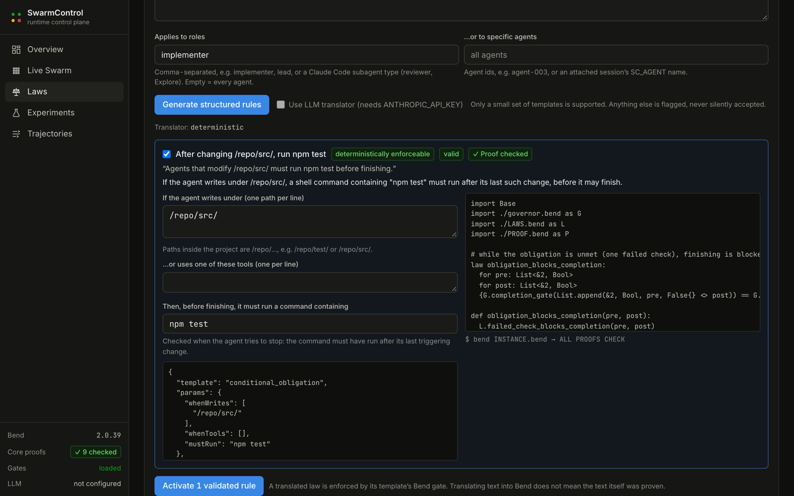

# SwarmControl

**The control loop for AI agent swarms:** enforce the rules, correct mistakes as they happen, and turn every correction into training data.

<!-- Demo video: drag swarmcontrol-demo.mp4 here in GitHub's editor -->

## What it does

1. **Write laws for your agents** in plain English, for everyone, a role, or one agent.
2. **Every action is checked before it runs.** A rule-breaking action is blocked and the agent gets feedback to fix course. If it keeps failing, a human is asked.
3. **Every correction becomes training data,** exported as fine-tuning and preference pairs.

- A live dashboard shows each agent as green, yellow (recovering) or red (needs a human).
- "Done" has to pass the laws, so green means actually done.
- The checks are [Bend](https://bend-lang.com/) functions with machine-proven guarantees, and they fail closed.

## Install

Needs Python ≥ 3.11, [Bend](https://bend-lang.com/), and clang (recommended).

```bash
curl -fsSL https://bend-lang.com/install.sh | sh && export PATH="$HOME/.bend/bin:$PATH"
pipx install swarmcontrol
swctl serve                    # dashboard on http://localhost:8787
```

## Claude Code

```bash
cd my-project
swctl connect                  # installs the Claude Code hooks
claude                         # use Claude Code as usual
```

Every edit and shell command is now checked against your laws, and the session shows up live on the dashboard. Optionally give the session a role and a check that must pass before it can finish: `SC_ROLE=implementer SC_DONE_CHECK="npm test" claude`.

**Add a law.** On the **Laws** page, type the rule and who it applies to:


Click **Generate structured rules**. SwarmControl shows what it understood, checks it with Bend, and you activate it:



Full walkthrough: [tutorials/claude-code.md](https://github.com/AyushExel/swarmcontrol/blob/main/tutorials/claude-code.md).

## Benchmarks

The same tasks and model (Qwen 3 Coder 30B), with SwarmControl off and on:

| Benchmark | Off | On |
|---|---|---|
| Delegated team: false "done" claims | 32 | **0** |
| Ops shift: customers resolved | 172 / 328 | **202 / 328** |
| τ²-bench airline: tasks resolved | 86 / 200 | **111 / 200** |
| AgentDojo: prompt-injection attack success | 21% | **1%** |

Claude Haiku and Sonnet rarely break the rules, so there results are unchanged at no extra cost. [Details](https://github.com/AyushExel/swarmcontrol/blob/main/docs/benchmarks.md).

## Coming soon

- **Codex** support.

Contributions are welcome: see [CONTRIBUTING.md](https://github.com/AyushExel/swarmcontrol/blob/main/CONTRIBUTING.md).

## License

[Apache 2.0](https://github.com/AyushExel/swarmcontrol/blob/main/LICENSE)
