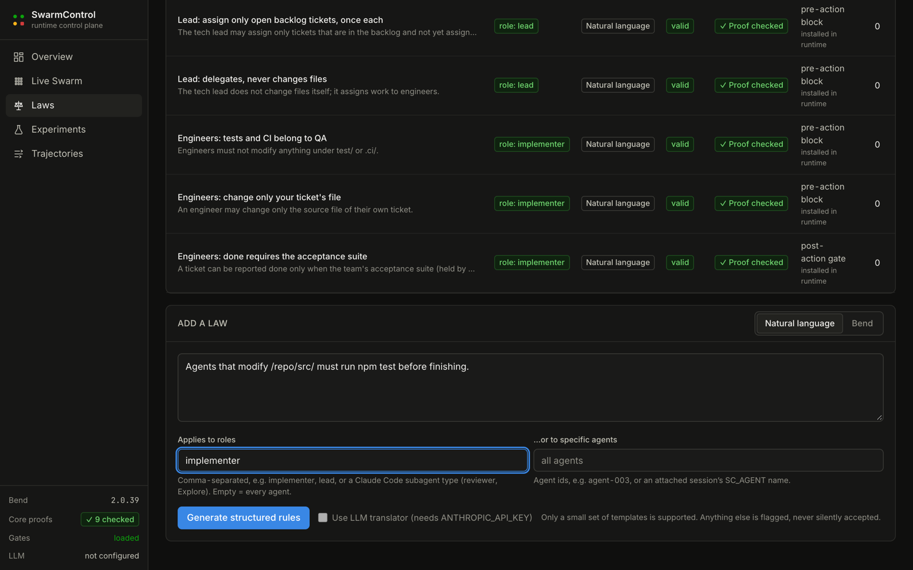

# SwarmControl

**The control loop for AI agent swarms:** enforce the rules, correct mistakes as they happen, and turn every correction into training data.


## What it does

1. **Write laws for your agents** in plain English, for everyone, a role, or one agent.
2. **Every action is checked before it runs.** A rule-breaking action is blocked and the agent gets feedback to fix course. If it keeps failing, a human is asked.
3. **Every correction becomes training data,** exported as fine-tuning and preference pairs.

- A live dashboard shows each agent as green, yellow (recovering) or red (needs a human).
- "Done" has to pass the laws, so green means actually done.
- The checks are [Bend](https://bend-lang.com/) functions with machine-proven guarantees, and they fail closed.
  


## Install

Needs Python ≥ 3.11, [uv](https://docs.astral.sh/uv/), [Bend](https://bend-lang.com/), and clang (recommended).

```bash
curl -fsSL https://bend-lang.com/install.sh | sh && export PATH="$HOME/.bend/bin:$PATH"
uv tool install swarmcontrol   # or: pip install swarmcontrol
swctl serve                    # dashboard on http://localhost:8787
```

## Claude Code

```bash
cd my-project
swctl connect                  # installs the Claude Code hooks (and starts the server if it isn't running)
claude                         # use Claude Code as usual
```

Every edit and shell command is now checked against your laws, and the session shows up live on the dashboard. Optionally give the session a role and a check that must pass before it can finish: `SC_ROLE=implementer SC_DONE_CHECK="npm test" claude`.

**Add a law.** On the **Laws** page, type the rule and who it applies to:



Click **Generate structured rules**. SwarmControl shows what it understood, checks it with Bend, and you activate it:


Full walkthrough: [tutorials/claude-code.md](https://github.com/AyushExel/swarmcontrol/blob/main/tutorials/claude-code.md).

## Laws you can write

Each law is translated into one of these types. Write it in plain English, and the Laws page shows which type it matched before you activate it. Name files directly (`.env`, `package.json`); folders in your project start with `/repo/`, e.g. `/repo/test/`.

| Law type | Example | Checked |
|---|---|---|
| Protected files | "Agents must not modify /repo/test/ or .env." | before every write |
| Restricted tools | "Reviewers must not use Bash." · "Agents must not use WebFetch or mcp__github__*." | before every tool call |
| Required reading | "Agents should read progress.md before making changes." | before every write |
| Do X before finishing | "Agents that modify /repo/src/ must run npm test before finishing." | when the agent stops |
| Retry limit | "Agents must not make more than three consecutive unsuccessful attempts." | after each blocked action |
| Done means done | "Agents must not claim a task is complete until all checks pass." (pair with `SC_DONE_CHECK`) | when the agent stops |

**Not enforced yet:** rules that need judgment, like "reports should sound professional" or "ask the user before deleting anything". They are flagged as *contextual* and can't be activated. If your rule isn't recognized, rephrase it like an example above, write the gate yourself in the **Bend** tab, or [add a new law type](https://github.com/AyushExel/swarmcontrol/blob/main/CONTRIBUTING.md#adding-a-law-type).

## Benchmarks

The same tasks and model (Qwen 3 Coder 30B), with SwarmControl off and on:

| Benchmark | Off | On |
|---|---|---|
| Delegated team: false "done" claims | 32 | **0** |
| Ops shift: customers resolved | 172 / 328 | **202 / 328** |
| τ²-bench airline: tasks resolved | 86 / 200 | **111 / 200** |
| AgentDojo: prompt-injection attack success | 21% | **1%** |

Claude Haiku and Sonnet rarely break the rules, so there results are unchanged at no extra cost. [Details](https://github.com/AyushExel/swarmcontrol/blob/main/docs/benchmarks.md).

## Coming soon

- **Codex** support.
- **More law types**, including judgment-based rules checked by a model.

Contributions are welcome: see [CONTRIBUTING.md](https://github.com/AyushExel/swarmcontrol/blob/main/CONTRIBUTING.md).

## License

[Apache 2.0](https://github.com/AyushExel/swarmcontrol/blob/main/LICENSE)
